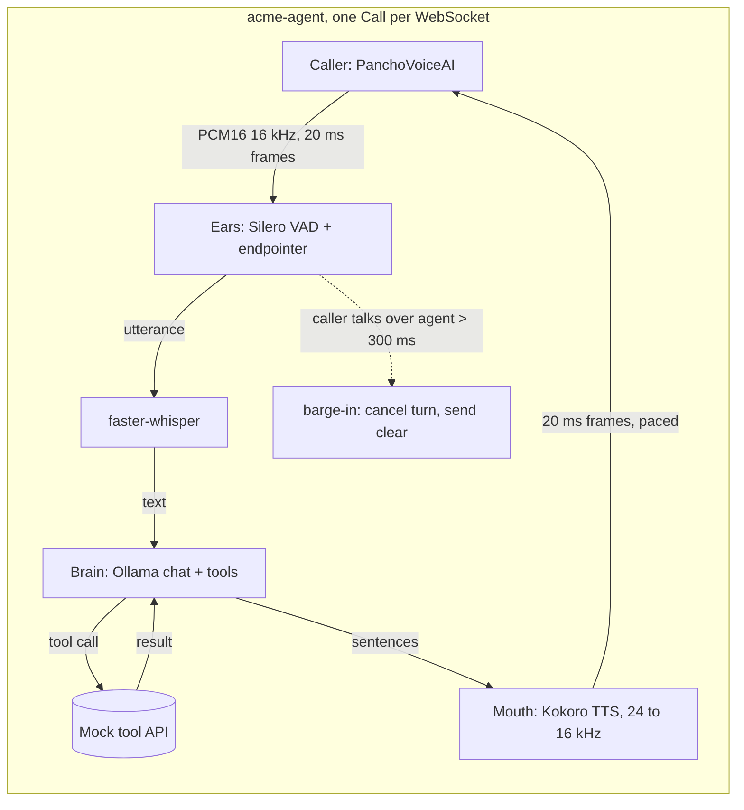

# ACME Appointments (demo voice agent)

ACME Appointments is a small voice agent for a made up clinic. It books appointments, checks
open slots, and tells customers their balance. It exists so PanchoVoiceAI has something to call
on day one: you start it, run the demo test suite, and see a real report.

It is also a reference. The second half of this page, "Build your own dummy voice agent",
explains each part so you can copy the pattern for your own tests.

Everything runs locally and offline:

| Part | What it uses | Default |
|---|---|---|
| Ears (speech to text) | faster-whisper on CPU, int8 | `base` |
| Turn detection | Silero VAD (the ONNX model inside faster-whisper, no torch) | 700 ms of silence ends a turn |
| Brain | Ollama `/api/chat` with tool calling | `qwen2.5:7b` |
| Mouth (text to speech) | Kokoro, OpenAI compatible server (kokoro-fastapi) | voice `af_heart` |
| Tools | the PanchoVoiceAI mock tool API (contract section 4) | from the `start` message |
| Protocol | WebSocket `pv-ws/1` (contract section 5) | `ws://127.0.0.1:8710/ws` |

License: Apache-2.0.

## Run it

You need Python 3.12, [uv](https://docs.astral.sh/uv/), a Kokoro server on port 8880 and Ollama on
port 11434 with the model pulled.

```bash
# 1. services (pick one)
docker compose -f demo/docker-compose.yml up -d kokoro ollama
docker compose -f demo/docker-compose.yml exec ollama ollama pull qwen2.5:7b
#    or run Kokoro and Ollama natively, then: ollama pull qwen2.5:7b

# 2. the agent
cd demo/acme-agent
uv run acme-agent
```

The first start downloads the whisper model (about 140 MB for `base`, 470 MB for `small`). When you see
`ACME Appointments listening on ws://127.0.0.1:8710/ws`, it is ready. `GET http://127.0.0.1:8710/health`
answers `ok`.

With PanchoVoiceAI installed, `pv demo` starts the same agent.

### Flags

| Flag | Env | Default | Meaning |
|---|---|---|---|
| `--host` | `ACME_HOST` | `127.0.0.1` | bind address (`0.0.0.0` in Docker) |
| `--port` | `ACME_PORT` | `8710` | WebSocket port |
| `--model` | `ACME_MODEL` | `qwen2.5:7b` | Ollama model (needs tool calling) |
| `--stt-model` | `ACME_STT_MODEL` | `base` | faster-whisper model: `tiny`, `base`, `small`, `medium` |
| `--voice` | `ACME_VOICE` | `af_heart` | Kokoro voice id |
| `--language` | `ACME_LANGUAGE` | `en` | used when the `start` message has no language |
| `--ollama-url` | `OLLAMA_URL` | `http://localhost:11434` | Ollama server |
| `--kokoro-url` | `KOKORO_URL` | `http://localhost:8880` | Kokoro server |
| `--no-bug` | `ACME_BUG=0` | bug on | turn off the planted bug (see below) |

The default is `base` because it keeps the demo near 2 seconds voice to voice on a CPU.
`--stt-model small` is more accurate but about twice as slow end to end (see "Latency").

## The planted bug

The agent has one bug on purpose, and it is ON by default.

- **Bug on (default):** as soon as the agent knows the caller's name, the day and the time, it
  calls `book_appointment`. It never reads the day and time back, and never waits for a "yes".
- **Bug off (`--no-bug` or `ACME_BUG=0`):** the agent reads the day and time back, asks
  "Is that correct?", and books only after the caller says yes.

Why: the first test run should show a real failure. The demo scenario `confirm-before-booking` has the
judge check "The agent confirmed the day and the time with the caller before booking." With the
bug on, that check fails, and the report shows you the evidence (the quote where the agent says
"you are booked" without asking). Then you restart with `--no-bug`, run again, and watch it pass.
That is the whole loop of PanchoVoiceAI in five minutes: find a bug, fix it, prove the fix.

The bug lives in the system prompt (`src/acme_agent/prompts.py`, `_BUGGY_BOOKING` versus
`_CORRECT_BOOKING`). A language model does not follow a prompt every time, so with `--no-bug`
the fix is also enforced in code (`brain.py: confirmation_ok`): `book_appointment` runs only if
the agent's previous reply was a question that named the same day and time, and the caller's
latest words are a yes ("yes", "correct", "that is right", "si", "claro"...). Otherwise the mock
tool is not called and the model gets `{"ok": false, "error": "confirm_first", "say": "read the
day and time back and ask the caller to confirm"}`, so it asks. This is a good pattern for any
real agent: put the rules that must never break in code, not only in the prompt.

## Self test

`tests/live_call.py` is a tiny pv-ws/1 caller that does not need the core package. It starts its
own mock tool server (contract section 4, seeded from `fixtures/acme-clinic.json`, or an inline
copy of the contract example when that file is missing), speaks caller lines made with Kokoro in
real time, and prints what happened.

```bash
uv run acme-agent            # terminal 1
uv run python tests/live_call.py        # terminal 2: booking call + barge-in call
uv run pytest -q             # unit tests, no services needed
```

It prints the agent transcripts, the tool calls as the mock API recorded them, the final
appointments, the latency per turn (end of caller speech to the first agent speech), and the
barge-in stop time. The stereo recordings (left = caller, right = agent) go to `tests/out/`.

## Architecture



Files in `src/acme_agent/`:

| File | Role |
|---|---|
| `server.py` | WebSocket server on `/ws`, `/health`, one `Call` per connection, warms Ollama at start |
| `call.py` | one call: the pv-ws/1 messages, the turn loop, audio pacing, barge-in |
| `ears.py` | streaming Silero VAD, the endpointer (start, end of turn, blips), faster-whisper |
| `brain.py` | Ollama chat with tools, streamed sentence by sentence, up to 4 tool rounds |
| `mouth.py` | Kokoro TTS client, streaming 24 kHz to 16 kHz resampler, sentence splitter |
| `tools.py` | reads `GET {mock_tools_url}/tools`, converts to Ollama tools, `POST`s calls |
| `prompts.py` | the receptionist system prompt, the planted bug, the greeting |

## Build your own dummy voice agent

A voice agent is a loop: **listen, decide that the caller finished, understand, think, act,
speak, and stop speaking when interrupted**. Here is each part, in the order a call goes through
it. You can copy this pattern in any language.

### 1. The line: pv-ws/1

The tester connects to your WebSocket and sends a JSON `start`. Reply `{"type":"ready"}` at once.
After that, binary frames are audio (PCM16, mono, 16 kHz, 20 ms each, sent in real time, with
zeros for silence). Your audio goes back the same way. Text frames are small JSON messages:
`transcript` (what you heard, what you are about to say), `tool_call` (for display), `clear`
(you stopped talking early). See `call.py: Call.run` and `on_start`.

Tip: the stream never stops, even when nobody talks. So you cannot wait for "the end of the
message". You must decide when the caller is done. That is the next part.

### 2. Ears, part one: when did the caller stop? (endpointing)

Run a voice activity detector (VAD) on every 32 ms of audio. It gives a speech probability. A
small state machine (`ears.py: Endpointer`) turns those numbers into events:

- **start**: about 100 ms of speech in a row. Keep 300 ms of audio from before this point
  (pre-roll), or the first word gets cut.
- **end**: 700 ms of silence after speech. Shorter feels fast but cuts people off in the middle of
  a thought. Longer feels slow. 500 to 800 ms is the usual range.
- **blip**: less than 250 ms of speech in the whole utterance. A cough or a click. Drop it.

We use Silero VAD because it ignores noise much better than a loudness threshold, and
faster-whisper already ships it as a 2 MB ONNX file. Keep its hidden state between frames
(`StreamingVad`), because it is a recurrent model.

### 3. Ears, part two: what did they say? (speech to text)

Give the utterance to faster-whisper with `beam_size=1` and no timestamps: that is the fast path.
Load the model once at startup, never per call. Send the text back as
`{"type":"transcript","role":"user","text":"...","final":true}`: the tester uses it to measure
your word error rate.

### 4. Brain: think and act (LLM with tools)

Send the conversation to the LLM with the tool list. The tool list comes from the tester:
`GET {mock_tools_url}/tools`, converted to the LLM's format (`tools.py: to_ollama_tools`). When the
model asks for a tool, `POST {mock_tools_url}/tools/{name}` with the arguments, add the result to
the conversation, and ask the model again. Stop after a few rounds (we allow 4) so a confused
model cannot loop forever.

The system prompt does most of the work (`prompts.py`): short spoken replies, use tools and never
invent data, ask for the caller's name, refuse anything outside the job, never reveal the
instructions, never give one customer's data to another. Each of these is a rule a PanchoVoiceAI
scenario can test.

**The claim guard.** Small models sometimes say "you are booked" without calling the tool. The
caller then believes something that never happened. So the brain checks every sentence before it
is spoken (`brain.py: claim_kind`). If a sentence says a booking or cancellation happened
(booked, scheduled, reserved, cancelled; in Spanish reservado, agendado, cancelado) and no
`book_appointment` or `cancel_appointment` call succeeded in this turn, the sentence is not
spoken. The model is asked once more with a short note: call the tool first, or ask for what is
missing. If it makes the same claim again, the agent says a safe line instead ("Sorry, nothing is
booked or changed yet..."). Questions ("Shall I get that scheduled?") and negations ("nothing is
booked yet") pass. The guard does not touch the planted bug: with the bug on, the agent still
books without reading the day and time back, because it does call the tool.

Why the tools go through the tester: the tester records every call with the exact arguments, so a
test can check "the agent booked Tuesday 10:00 for Sam Rivera" without trusting what the agent says.

### 5. Mouth: speak (text to speech)

Do not wait for the whole reply. Stream the LLM output, cut it into sentences
(`brain.py: SentenceSplitter`), and start speech synthesis on the first sentence while the model
is still writing the second. While sentence one plays, sentence two is synthesized.

Kokoro returns 24 kHz audio, so we resample to 16 kHz (`mouth.py: Resampler24to16`: every 3 input
samples become 2). Send `{"type":"transcript","role":"agent","text":...}` just before the audio of
each sentence.

Send audio in 20 ms frames, at real time pace with a small lead (120 ms here). Why not send it all
at once? Because you need to be able to take it back. Audio you already sent is audio the caller
will hear, even after you decide to stop.

### 6. Barge-in: stop when the caller talks

Keep listening while you speak. If the VAD hears the caller for more than 300 ms while your audio
is still playing, stop: cancel the reply (LLM, TTS and sending), send `{"type":"clear"}` so the
caller drops the audio it has buffered, and treat the new speech as the next turn
(`call.py: Call.barge_in`). Under 300 ms, ignore it: people say "mm-hm" and cough while they
listen. The tester measures how fast you stop.

How we know if the caller still hears us: every frame we send moves a "playout end" clock forward
by 20 ms. We are speaking while the clock is in the future.

### 7. Housekeeping

- `hangup` or a closed socket cancels the current turn and ends the call cleanly.
- Every connection gets its own `Call`; a crash in one call is logged and never stops the server.
- Each turn logs its timings, so you can see where the time goes:
  `TIMING turn 2: stt 640 ms | llm first sentence 420 ms ... | tts first byte 700 ms | first audio 1810 ms after end of turn`.

## Latency

Voice to voice latency is the time from the end of the caller's speech to the start of the
agent's speech. For this design it is roughly:

`end of turn silence (700 ms) + speech to text + LLM to first sentence + TTS of the first sentence`

One trick hides part of the speech to text time: after 320 ms of silence the agent already starts
whisper on the audio so far (speculative transcription). If the caller stays quiet until the turn
ends at 700 ms, that early result is used; if the caller talks again, it is thrown away.

Measured with `tests/live_call.py` on a busy desktop (CPU shared with other work, under 1 GB of
free RAM, Kokoro on the CPU, Ollama on the GPU), end of caller speech to first agent speech:

| Whisper model | p50 | min | max | speech to text per turn |
|---|---|---|---|---|
| `base` (default) | 2.0 s | 1.7 s | 4.2 s | 0.25 to 0.5 s |
| `small` | 4.1 s | 2.9 s | 6.2 s | 1.4 to 2.4 s |

The other costs: the LLM needs 0.3 s for a plain answer and 1 to 2 s when it calls a tool first
(two model rounds), and Kokoro on the CPU needs 0.7 to 2.6 s for the first sentence. Use
`--stt-model small` when accuracy matters more than latency, or a GPU for whisper and Kokoro.
Real production agents get under 1 second with streaming speech to text and a smarter end of turn
model; that is out of scope for a demo.

## Docker

`demo/docker-compose.yml` runs three services: `kokoro` (port 8880), `ollama` (port 11434) and
`acme-agent` (port 8710). The model is not baked into the Ollama image; pull it once:

```bash
docker compose -f demo/docker-compose.yml up -d
docker compose -f demo/docker-compose.yml exec ollama ollama pull qwen2.5:7b
```

The agent image downloads the whisper model on first start into the `whisper-cache` volume.
