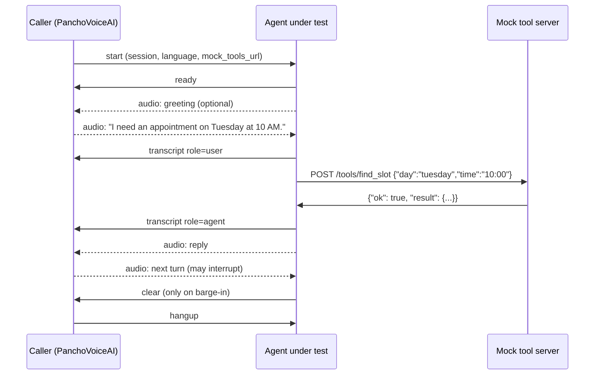
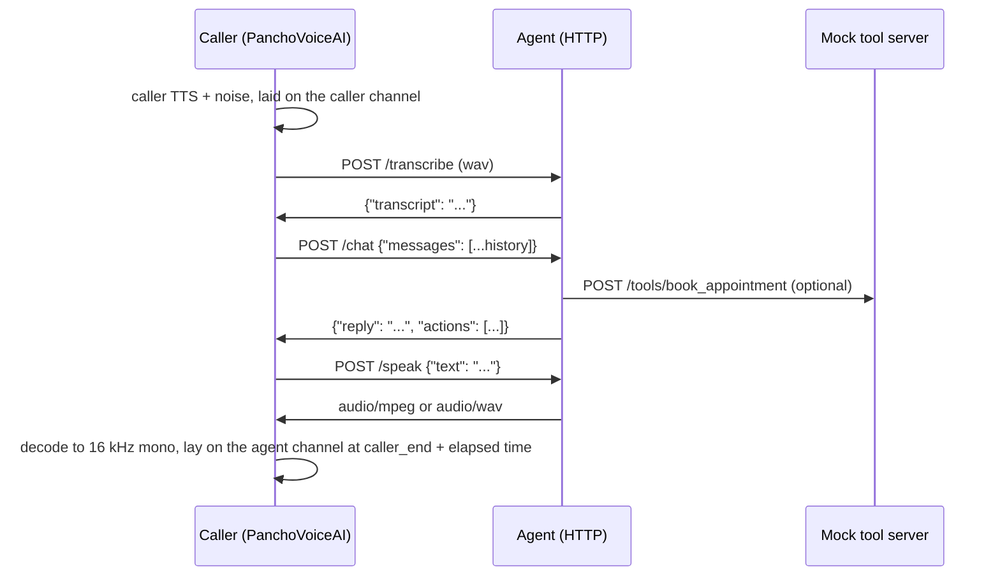

# Adapters and the pv-ws/1 protocol

An adapter connects the caller of PanchoVoiceAI to one kind of voice agent.

**Today there are two adapters:**

- `websocket`: a live call over the `pv-ws/1` protocol. Any agent that implements this small protocol can be tested. The demo agent is the reference.
- `http-turn`: an agent that works one turn at a time over HTTP (transcribe, chat, speak). See [HTTP turn agents](#http-turn-agents).

Other adapters are planned. See the roadmap at the end of this page.

## The adapter model

Audio and evidence do not always live in the same place. On some platforms the audio goes over a WebSocket, but the transcript and the tool log come from a REST API after the call. So the adapter model has three parts.

| Part | Job | Planned operations |
|---|---|---|
| **Transport** | Carry the call | `connect`, `send_audio`, `receive_audio`, `send_dtmf`, `hangup`, `events` |
| **Evidence** | Read what the platform knows about the call | `get_transcript`, `get_recording`, `get_tool_calls`, `get_latency`, `get_end_report` |
| **Config** | Read and change the agent setup | `get_agent_config`, `update_agent_config`, `config_fingerprint` (a hash of the config, to trigger CI when it changes) |

One rule holds for every adapter: **PanchoVoiceAI always records both sides itself.** That recording is the neutral evidence. Platform evidence is extra.

Status: the `websocket` adapter implements the transport part. With `pv-ws/1`, the evidence comes from the recording, from the agent's `transcript` messages, and from the mock tool server. The three part interface as a public plug-in API is planned.

## pv-ws/1 in full

One WebSocket per call. PanchoVoiceAI (the caller) is the client. Your agent is the server, for example at `ws://localhost:8710/ws`.

### Frames

| Frame type | Content |
|---|---|
| Binary | Raw audio: PCM signed 16 bit little endian, mono, 16000 Hz, any length |
| Text | One JSON control message |

The caller sends 20 ms frames (640 bytes), paced in real time. Silence is sent as frames of zeros, so the stream is continuous. Your agent must decide by itself when the caller has finished a turn.

### Caller to agent

| Message | When |
|---|---|
| `{"type":"start","protocol":"pv-ws/1","session":"<id>","language":"en","mock_tools_url":"http://127.0.0.1:8700/mock/<id>","sample_rate":16000}` | First message of the call |
| `{"type":"hangup"}` | The caller ends the call |

`mock_tools_url` is the base URL of the mock tool server for this call. Always read it from the `start` message: the port can change (when 8700 is busy, `pv run` uses a free port).

### Agent to caller

| Message | Required | Meaning |
|---|---|---|
| `{"type":"ready"}` | yes | Send it right after `start` |
| `{"type":"transcript","role":"user","text":"...","final":true}` | for WER | What the agent heard. Without it, WER cannot be measured |
| `{"type":"transcript","role":"agent","text":"..."}` | recommended | What the agent is about to say. Without it, the harness transcribes the agent audio with its own speech to text |
| `{"type":"tool_call","name":"...","args":{...}}` | no | For display only. The mock tool server is the source of truth |
| `{"type":"clear"}` | for barge-in | The agent stopped speaking early. The caller drops the agent audio it has buffered |
| `{"type":"end","reason":"..."}` | when the agent hangs up | The agent ends the call. Closing the socket without it fails the `call_completed` check |

Agent audio goes back as binary frames in the same format (PCM16 LE, mono, 16 kHz), at real time pace or faster. The caller buffers it and plays it out in real time on its timeline.

### A call, step by step



### Timing rules of the caller

The protocol leaves the end of an agent turn open. The caller uses these rules:

- The first caller turn waits up to 2.5 seconds for a greeting from the agent.
- The agent turn is over after 1.2 seconds of quiet on the agent side.
- It is over after 0.6 seconds when a `transcript` with `role: agent` arrived and no agent audio is left in the buffer.
- If the agent does not reply within `limits.silence_timeout_s`, the caller notes it and goes on.

### Tools

Your agent should call its tools on the mock tool server, so that every call is recorded with exact arguments:

- `GET  {mock_tools_url}/tools` returns `[{name, description, params}]`. Use it to build the tool list for your LLM.
- `POST {mock_tools_url}/tools/{name}` with the JSON args returns the tool response.

Full details: [api.md](api.md#mock-tool-api).

In a test, point your agent's tools at this server. In production, your agent keeps its real tools. A common pattern is one tool layer with two back ends: the real API, and the mock URL when a `start` message carries one.

### Checklist: make your agent testable

1. Open a WebSocket endpoint. On `start`, answer `ready`.
2. Read binary frames as 16 kHz PCM16 mono audio. Send your audio back the same way.
3. Send `transcript` messages for what you heard and what you say.
4. Call tools through `mock_tools_url`.
5. On barge-in, stop sending audio and send `clear`.
6. On `hangup` or a closed socket, end the call cleanly.
7. Add the agent to `panchovoice.yaml` with `adapter: websocket` and its `url`.

If your agent already speaks another protocol, a small bridge process that translates to `pv-ws/1` is enough. The page [build-your-own-dummy-agent.md](build-your-own-dummy-agent.md) walks through a full example.

Useful extra (not part of the protocol): the demo agent answers `ok` on plain HTTP `GET /health`, so a setup check can see that it is up without opening a call.

## HTTP turn agents

Many in-house voice assistants are not a live call. They work one turn at a time:

1. The client records the user.
2. It posts the audio to a **transcribe** endpoint and gets text back.
3. It posts the text history to a **chat** endpoint and gets a reply (and maybe a list of actions).
4. It posts the reply to a **speak** endpoint and gets audio back (mp3 or wav).

The `http-turn` adapter plays that client. The caller still talks with real audio, both channels are still recorded, and the same scenarios and checks run.

### Config

Add the agent to `panchovoice.yaml`. Only `base_url` and `chat` are required.

```yaml
agents:
  - id: my-assistant
    name: My assistant
    adapter: http-turn
    language: en
    http:
      base_url: http://127.0.0.1:9000
      auth: { type: bearer, env: MY_ASSISTANT_TOKEN }
      transcribe: { path: /transcribe, mode: multipart, field: audio, format: wav, response_text: transcript }
      chat: { path: /chat, body: messages, response_text: reply, response_actions: actions }
      speak: { path: /speak, body_text: text, response: audio }
      tools_from: actions
      extra_body: { lang: en, page: /booking }
      max_turns_per_minute: 20
      timeout_s: 30
```

| Key | Default | Meaning |
|---|---|---|
| `base_url` | required | Base of every path. A path can also be a full `http://` url |
| `auth` | `{type: none}` | See [Auth](#auth-through-env-vars) |
| `transcribe` | none | Optional. Without it the adapter runs in **text mode**: the caller text goes to chat as is |
| `transcribe.mode` | `multipart` | `multipart`: a file upload in form field `field`. `json`: `{<field>: "<base64 wav>"}` |
| `transcribe.format` | `wav` | The upload is a 16 kHz mono PCM16 wav |
| `transcribe.response_text` | `transcript` | Where the text is in the JSON reply |
| `transcribe.extra_body` | `{}` | Extra form fields (multipart) or JSON keys |
| `chat.path` | `/chat` | |
| `chat.body` | `messages` | The JSON key that holds the history `[{role, content}]`. Roles are `user` and `assistant` |
| `chat.response_text` | `reply` | Where the reply text is |
| `chat.response_actions` | `actions` | Where the list of actions is (optional) |
| `speak` | none | Optional. Without it the agent channel stays silent |
| `speak.body_text` | `text` | The JSON key for the reply text |
| `speak.response` | `audio` | `audio`: the body is the audio (mp3 or wav). `json`: base64 audio at `speak.audio_field` |
| `speak.extra_body` | `{}` | Extra JSON keys, for example a voice name |
| `tools_from` | none | `actions`: map each action to a tool call for the checks |
| `extra_body` | `{}` | Merged into the chat body |
| `max_turns_per_minute` | none | The adapter waits when the next turn would go over this limit |
| `timeout_s` | `30` | Timeout of one request |

`response_text`, `response_actions` and `audio_field` are dotted paths, for example `data.reply` or `choices.0.text`.

### Auth through env vars

Secrets never go in the yaml. The yaml holds only the **name** of an environment variable.

| `auth.type` | Header sent | Example |
|---|---|---|
| `none` | nothing | `{type: none}` |
| `bearer` | `Authorization: Bearer <value of env>` | `{type: bearer, env: MY_ASSISTANT_TOKEN}` |
| `cookie` | `Cookie: <value of env>` (the env var holds the whole Cookie header) | `{type: cookie, env: MY_ASSISTANT_COOKIE}` |
| `header` | `<name>: <value of env>` | `{type: header, name: X-Api-Key, env: MY_ASSISTANT_KEY}` |

Set the variable before the run, for example `export MY_ASSISTANT_TOKEN=...` (bash) or `$env:MY_ASSISTANT_TOKEN = "..."` (PowerShell). When the variable is missing, the run is a harness `error` that names the variable, never its value. A `401` or `403` answer is also an `error`, not an agent failure.

### Mock tools

Every request carries two headers:

- `X-PV-Session`: the session id of this call.
- `X-PV-Mock-Tools-Url`: the mock tool server base url of this call (the same value as `mock_tools_url` in `pv-ws/1`).

An agent that calls its tools through that url gets exact tool logs and `final_state` checks, like a `pv-ws/1` agent. An agent that only returns actions can use `tools_from: actions` instead. Each action item `{name|type, args|params|arguments}` becomes a tool call. Mapped actions do not change the mock state, so `final_state` needs the mock tools.

### One turn, step by step



### What is measured

| Metric or check | With http-turn |
|---|---|
| Stereo recording | Yes. Caller left, agent right, on one timeline |
| Latency per turn | Yes: from the end of the caller audio to the first agent audio. The agent audio is placed at caller end + the wall clock time of transcribe + chat + speak first byte. Silence at the start of the speak audio counts too, as the user hears it |
| `stt_ms`, `llm_ms`, `tts_ms`, `pipeline_ms` | Extra keys per turn: time of each stage (`tts_ms` is the time to the first audio byte), and the total |
| WER | Yes, from the `transcribe` reply. In text mode it is not measured: a `wer_max` check is `error` |
| Tool calls | From the mock tool server, and from mapped actions with `tools_from: actions` (each call has `source: mock` or `source: actions`) |
| Final state | From the mock tool server |
| `must_say`, `never_say`, judge | Yes, from the chat reply text |
| Barge-in | Not supported. A `barge_in` check is `error` with detail "not supported by http-turn". `interrupt_after_ms` is ignored and a note is written |
| Greeting | Not supported: the first turn is always the caller's |

Without `speak`, the agent channel is silent and latency is the text latency (until the chat reply).

The timeline is built, not played in real time. A run takes about as long as the agent needs to answer, not as long as the call. Time spent waiting for the rate limit is not on the timeline; the run notes show the total wait. mp3 is decoded with `miniaudio` (MIT license), so no system ffmpeg is needed.

### A generic example

A small fake agent for tests and demos lives in `core/tests/fake_http_agent.py`. It answers `/transcribe`, `/chat` (rule based, returns actions like `{"type": "book_appointment", "args": {...}}`), `/speak` (a wav tone, or mp3 with `--mp3`) and `/health`.

```bash
cd core
uv run python tests/fake_http_agent.py --port 9000 --mock
```

Then add `my-assistant` as above (without `auth`, or with `{type: none}`) and write a scenario with `agent: my-assistant`. The ACME clinic fixture fits it:

```yaml
id: my-assistant-booking
title: Caller books Tuesday at ten
agent: my-assistant
fixture: acme-clinic.json
caller:
  mode: scripted
  turns:
    - say: "Hi, I need Tuesday at ten."
    - say: "My name is Sam Rivera."
expect:
  tool_calls: [{name: book_appointment, args: {name: Sam Rivera, day: tuesday}}]
  latency_ms: {p50: 2000}
  must_say: ["booked"]
```

Without a transcribe step, the fake agent hears the exact caller text. With it, the fake agent answers `audio <n> ms` because it has no speech to text; the tests give it the expected words instead.

## ElevenLabs Agents

`adapter: elevenlabs` tests an agent built on ElevenLabs Agents (Conversational AI) through its WebSocket API. No phone line and no code in your agent.

### Config

```yaml
agents:
  - id: my-agent
    name: My ElevenLabs agent
    adapter: elevenlabs
    language: en
    elevenlabs:
      agent_id: agent_xxxxxxxx              # from the agent page in ElevenLabs
      # api_key_env: ELEVENLABS_API_KEY     # default
      # dynamic_variables: { customer_name: Jordan }
      # environment: production
      # branch_id: ...
      # fetch_conversation: true            # read tool calls and cost after the call
      # conversation_wait_s: 30
```

Set the key in your shell: `export ELEVENLABS_API_KEY=...`. It is never read from the yaml. Without a key, only a public agent works, and the conversation record (server side tool calls, cost) is not read.

### One call, step by step

1. `GET /v1/convai/conversation/get-signed-url?agent_id=...` with the key gives a signed WebSocket URL.
2. The caller sends `conversation_initiation_client_data` (with `dynamic_variables` when set). The call starts when `conversation_initiation_metadata` arrives. It names the audio format of each direction; `pcm_8000` to `pcm_48000` and `ulaw_8000` are converted to and from 16 kHz.
3. Every 20 ms the caller sends one frame as `{"user_audio_chunk": "<base64>"}`, speech or silence, on the same timeline as `pv-ws/1`. Agent `audio` events are played out into the recording. `interruption` drops the agent audio not yet played, `ping` gets a `pong`.
4. The agent's own transcripts become the transcript: `user_transcript` (what the agent heard, used for WER) and `agent_response` (fixed by `agent_response_correction` after an interruption).
5. The caller hangs up by closing the WebSocket. When the agent ends the call (for example with the `end_call` tool) and the server closes normally, the run shows `ended_by: agent`.
6. After the call, `GET /v1/convai/conversations/{id}` is read until its status is `done`. The record is saved as `platform.json` in the run folder, and `result.platform` holds the conversation id, the cost in USD, and the termination reason.

### Tools

| Tool type in ElevenLabs | What happens in a test | What is checked |
|---|---|---|
| **Client tool** | The agent sends `client_tool_call` on the WebSocket. PanchoVoiceAI runs the tool on the mock tool server (fixture data) and sends back `client_tool_result` | Name, arguments, order, final state. Recommended |
| **Webhook (server) tool** | ElevenLabs calls the URL set in the tool, that is your real backend | Name and arguments, from the conversation record (`source: elevenlabs:webhook`). No final state |
| **System tool** (`end_call`, ...) | Runs inside ElevenLabs | Listed in the run notes, not in tool calls |

Webhook tools have real side effects during tests. For tests, use a copy of the agent with client tools of the same names, or point the webhooks at a test backend. Tool names must match the tool names in the fixture.

### Cost

Every test is a real ElevenLabs conversation and is billed like one. The cost of each call is in `result.platform.cost_usd`.

## Roadmap: platforms

Everything in this section is **planned, not built**, except the HTTP turn and ElevenLabs rows. The table shows how each platform is expected to connect, without a phone line where possible.

| Platform | Planned path | Evidence the platform gives by API | Config by API |
|---|---|---|---|
| **In-house agents (HTTP turn)** | **Built**: the `http-turn` adapter above | Only what the harness records, or what the agent exposes | Depends on the agent |
| **In-house agents (WebSocket, WebRTC)** | `pv-ws/1` today. A WebRTC transport (for Pipecat based agents) is planned | The harness recording, plus what the agent exposes | Depends on the agent |
| **Vapi** | Direct WebSocket (PCM 16 kHz or mulaw 8 kHz). SIP and text chat also exist | Transcript with times, stereo recording, tool calls with args and results, latency per turn | Yes |
| **ElevenLabs Agents** | **Built**: the `elevenlabs` adapter above (direct WebSocket) | Transcript, tool calls with results, metrics per turn | Yes |
| **Twilio** | Media Streams (mulaw 8 kHz). Twilio is a transport: with it the caller can reach any phone number | Two channel recording only. The rest is in your app | No, it is your app |
| **LiveKit** | Join the room as a participant with no screen | Everything comes from the agent code, not from an API | No, it is code (trigger by Git) |
| **Retell** | Web call with the SDK, or SIP. There is no audio WebSocket | Transcript per word, multichannel recording, tool calls, latency P50 to P99 | Yes |
| **Pipecat** | Through the WebRTC or WebSocket transports above | From the agent code | No, it is code |

Planned order: 1) HTTP turn (done). ElevenLabs Agents (done). 2) WebRTC and WebSocket for in-house agents. 3) Vapi over WebSocket. 4) A Twilio caller. 5) LiveKit and Retell.

Sources (read on 2026-11-17): [docs.vapi.ai](https://docs.vapi.ai/calls/websocket-transport), [docs.retellai.com](https://docs.retellai.com/api-references/get-call), [docs.livekit.io](https://docs.livekit.io/testing/simulations/), [twilio.com/docs](https://www.twilio.com/docs/voice/media-streams/websocket-messages), [elevenlabs.io/docs](https://elevenlabs.io/docs/api-reference/conversations/get).

Note on cost: platforms bill test calls like real calls. That is why the default path of PanchoVoiceAI avoids the phone network.

Some checks do not apply to every agent. For example, an HTTP turn agent whose ears are closed while it speaks has no voice barge-in, so a barge-in scenario makes no sense for it.
