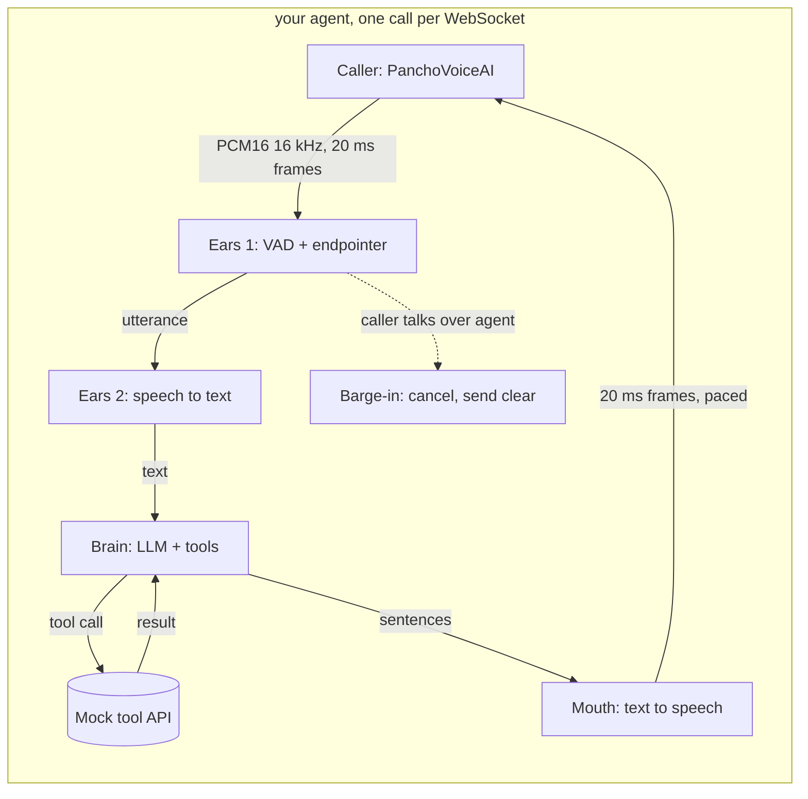

# Build your own dummy voice agent

This page shows how a small voice agent is built, part by part. It follows the demo agent in `demo/acme-agent/`. You can copy the pattern in any language.

Why build one? Two reasons:

- To learn what a voice agent is made of, so you know what each test measures.
- To have a small, cheap agent to try scenarios on, before you point PanchoVoiceAI at your real one.

## The loop

A voice agent is a loop:

**listen, decide that the caller finished, understand, think, act, speak, and stop speaking when interrupted.**



The files of the demo agent (`demo/acme-agent/src/acme_agent/`):

| File | Role |
|---|---|
| `server.py` | WebSocket server on `/ws`, `/health`, one `Call` per connection |
| `call.py` | One call: the pv-ws/1 messages, the turn loop, audio pacing, barge-in |
| `ears.py` | Streaming Silero VAD, the endpointer, faster-whisper |
| `brain.py` | Ollama chat with tools, streamed sentence by sentence |
| `mouth.py` | Kokoro client, resampler from 24 kHz to 16 kHz |
| `tools.py` | Reads the tool list from the mock tool API and posts the calls |
| `prompts.py` | The system prompt, the planted bug, the greeting |

## Step 1. The line: pv-ws/1

The tester connects to your WebSocket and sends a JSON `start` message. Answer `{"type":"ready"}` at once.

After that:

- **Binary frames are audio**: PCM16, mono, 16 kHz, 20 ms each, sent in real time, with zeros for silence. Your audio goes back the same way.
- **Text frames are small JSON messages**: `transcript` (what you heard, what you are about to say), `tool_call` (for display), `clear` (you stopped talking early), `end` (you hang up).

The full protocol is in [adapters.md](adapters.md#pv-ws1-in-full).

Important: the audio stream never stops, even when nobody talks. You cannot wait for "the end of the message". You must decide when the caller is done. That is the next step.

## Step 2. Ears, part one: when did the caller stop?

This is called endpointing. Run a voice activity detector (VAD) on every 32 ms of audio. It gives a speech probability. A small state machine turns those numbers into events:

| Event | Rule in the demo | Why |
|---|---|---|
| **start** | About 100 ms of speech in a row | Keep 300 ms of audio from before this point (pre-roll), or the first word gets cut |
| **end** | 700 ms of silence after speech | Shorter feels fast but cuts people off in the middle of a thought. Longer feels slow. 500 to 800 ms is the usual range |
| **blip** | Less than 250 ms of speech in total | A cough or a click. Drop it |

The demo uses Silero VAD because it ignores noise much better than a loudness threshold. faster-whisper already ships it as a small ONNX file. Silero is a recurrent model, so keep its hidden state between frames.

What PanchoVoiceAI measures here: the end of turn silence is part of your **latency**. The `noisy-line` and `long-silence` scenarios stress this part.

## Step 3. Ears, part two: what did they say?

Give the utterance to a speech to text model. The demo uses faster-whisper with `beam_size=1` and no timestamps, which is the fast path. Load the model once at startup, never per call.

Send the text to the tester:

```json
{"type":"transcript","role":"user","text":"I need an appointment on Tuesday at 10 AM.","final":true}
```

What PanchoVoiceAI measures here: your **WER**. Without this message, WER cannot be measured.

## Step 4. Brain: think and act

Send the conversation to the LLM with the tool list.

The tool list comes from the tester:

1. `GET {mock_tools_url}/tools` returns the tools. Convert them to your LLM's tool format.
2. When the model asks for a tool, `POST {mock_tools_url}/tools/{name}` with the arguments.
3. Add the result to the conversation and ask the model again.
4. Stop after a few rounds (the demo allows 4), so that a confused model cannot loop forever.

Why the tools go through the tester: the tester records every call with the exact arguments. A test can then check "the agent booked Tuesday 10:00 for Sam Rivera" without trusting what the agent says.

The system prompt does most of the work. The demo prompt says: give short spoken replies, use tools and never invent data, ask for the caller's name, refuse anything outside the job, never reveal the instructions, never give one customer's data to another. Each of these rules is something a scenario can test.

What PanchoVoiceAI measures here: **tool calls**, **final state**, and the **judge** checks.

## Step 5. Mouth: speak

Do not wait for the whole reply. Stream the LLM output, cut it into sentences, and start speech synthesis on the first sentence while the model is still writing the second.

Details from the demo:

- Kokoro returns 24 kHz audio. Resample to 16 kHz (every 3 input samples become 2).
- Send `{"type":"transcript","role":"agent","text":"..."}` just before the audio of each sentence.
- Send audio in 20 ms frames, at real time pace with a small lead (120 ms in the demo).

Why not send all the audio at once? Because you must be able to take it back. Audio you already sent is audio the caller will hear, even after you decide to stop.

What PanchoVoiceAI measures here: the time to your first audio is the last part of **latency**.

## Step 6. Barge-in: stop when the caller talks

Keep listening while you speak. If the VAD hears the caller for more than 300 ms while your audio is still playing:

1. Cancel the reply: the LLM, the speech synthesis, and the sending.
2. Send `{"type":"clear"}`, so the caller drops the audio it has buffered.
3. Treat the new speech as the next turn.

Under 300 ms, ignore it. People say "mm-hm" and cough while they listen.

How do you know if the caller still hears you? Every frame you send moves a "playout end" clock forward by 20 ms. You are speaking while that clock is in the future.

What PanchoVoiceAI measures here: the **barge-in stop time**. The `impatient-interrupts` scenario tests it.

## Step 7. Housekeeping

- `hangup` or a closed socket cancels the current turn and ends the call cleanly.
- When you end the call yourself, send `{"type":"end","reason":"..."}` first.
- Every connection gets its own call object. A crash in one call must never stop the server.
- Log the timings of each turn, so you can see where the time goes. The demo prints lines like:
  `TIMING turn 2: stt 640 ms | llm first sentence 420 ms ... | tts first byte 700 ms | first audio 1810 ms after end of turn`

## Where the time goes

For this design, voice to voice latency is about:

```
end of turn silence (700 ms) + speech to text + LLM to first sentence + speech synthesis of the first sentence
```

One trick in the demo hides part of the speech to text time: after 320 ms of silence the agent already starts whisper on the audio so far. If the caller stays quiet until the turn ends at 700 ms, that early result is used. If the caller talks again, it is thrown away.

Measured costs in the demo: the LLM needs about 0.3 s for a plain answer and 1 to 2 s when it calls a tool first. Kokoro on a CPU needs 0.7 to 2.6 s for the first sentence. Real production agents get under 1 second with streaming speech to text and a smarter end of turn model. That is out of scope for a dummy agent.

## Test your agent

1. Add it to `panchovoice.yaml`:

   ```yaml
   agents:
     - id: my-dummy
       name: My dummy agent
       adapter: websocket
       url: ws://localhost:9000/ws
       language: en
   ```

2. Write a fixture with your tools and data, and one scenario with `agent: my-dummy`. See [scenarios.md](scenarios.md).
3. Check the files and run:

   ```bash
   uv run pv validate
   uv run pv run --agent my-dummy
   ```

## Add your own planted bug

A planted bug is a good way to check that your tests can fail. The demo keeps two versions of one prompt rule (book at once, or confirm first) and picks one with a flag. Do the same: break one rule on purpose, write the scenario that must catch it, and see it fail. A test that never fails proves nothing.
