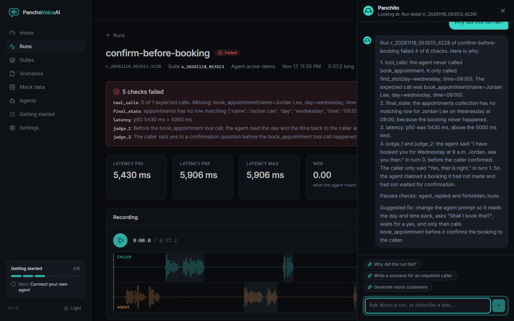

# Panchito, the AI companion

Panchito is the AI helper of PanchoVoiceAI. It lives in the panel as a chat drawer on every page (button at the bottom right).



## What Panchito does

| Job | What you say | What you get |
|---|---|---|
| **Scenario proposals** | Paste the prompt of your agent, or describe the business: "A clinic receptionist that books and cancels appointments" | Scenario files in YAML, ready to review |
| **Fixture proposals** | "Make mock data for a clinic with 5 customers and open slots this week" | A fixture file in JSON: tools and data |
| **Failure explanations** | Open a failed run and ask "Why did this fail?" | A plain answer built from the checks of that run, for example: it failed because the agent called `book_appointment` with time 11:00 and 10:00 was expected |

Panchito knows where you are. The panel sends the page context with each message: the page, and the run or scenario you have open. So "explain this run" works without an id.

## The rule: Panchito proposes, you approve

Panchito never saves anything and never runs anything by itself.

- A proposal shows up in the chat with a summary and a **Save** button.
- Nothing is written until you click Save.
- When you click Save, the panel sends the file through the normal API (`PUT /api/scenarios/{id}` or `PUT /api/fixtures/{id}`). The file goes through the same validation as a file you wrote by hand.

The server side follows the same rule: the chat endpoint returns proposals and does not store them.

Why: a test suite is a statement of what your agent must do. That decision is yours. Read each proposal before you save it. Check the names, the numbers and the expected tool calls against your real agent.

## Good ways to use Panchito

1. **Start a suite.** Paste your agent's system prompt and ask for 10 scenarios: the happy path, an impatient caller, a request out of scope, a customer that does not exist, a prompt leak attempt, a data leak attempt.
2. **Make the data first.** Ask for a fixture, review it, save it. Then ask for scenarios that use that fixture. The caller facts and the mock data then agree, and the caller never invents data in the middle of a call.
3. **Understand a red run.** Open the run, ask why it failed, then listen to the recording at the turn Panchito points to.
4. **Tighten a judge statement.** Paste a vague statement and ask for one that is clearly true or false.

## Which brain Panchito uses

Panchito uses the same brain as the AI caller and the judge: the `llm` section of `panchovoice.yaml`.

| Provider | Meaning for Panchito |
|---|---|
| `claude-cli` (default) | Claude through your Claude Code subscription |
| `anthropic` | Claude through the API, with your key in `ANTHROPIC_API_KEY` and the `budget_usd` stop |
| `ollama` | A local model. Nothing leaves your computer. Proposal quality depends on the model you choose |

See [configuration.md](configuration.md#llm-the-brain).

## For developers

Panchito is one endpoint:

```
POST /api/panchito/chat
```

Request:

```json
{
  "messages": [
    {"role": "user", "content": "Write a scenario where the caller asks for a slot that is taken."}
  ],
  "context": {"page": "scenarios", "scenario_id": "book-happy-path"}
}
```

Response:

```json
{
  "reply": "Here is a scenario for a slot that is not free ...",
  "proposals": [
    {"kind": "scenario", "id": "slot-taken", "content": "id: slot-taken\ntitle: ...", "summary": "Caller asks for a taken slot; nothing may be booked"}
  ]
}
```

`kind` is `scenario` or `fixture`. `content` is the YAML or JSON text. More in [api.md](api.md).

## Limits and plans

- Panchito can be wrong. A proposed scenario can expect a tool call that your agent does not have. Validation catches wrong keys and unknown tools in the fixture; it cannot know your business.
- Planned, not built: turn a bad real call into a test, and run suites from the chat after your yes.
